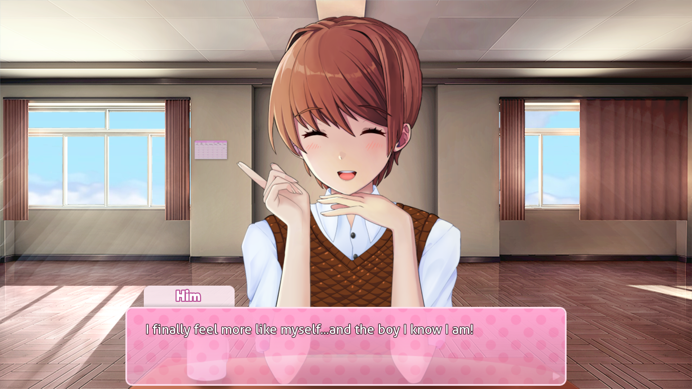

# Transika: A Monika After Story Submod

A submod for Monika After Story that makes your Monika transgender, female to male!

## What this submod does and doesn't do
### DOES:
-  Replace instances of "Monika" with your nickname for him
-  Overwrite topics to change pronouns
-  Make him mention being a trans man occasionally
-  Add new dialogue for some things to make sense (e.g. why he wears dresses)
-  Add 11 new topics for you to discuss + one opening "coming out" topic
-  Add 1 new giftable
### DOES NOT:
- Change submod dialogue. If submods are installed that refer to him as female, sorry I can't fix that
- Change his appearance. There are [a few spritepacks](https://github.com/ifitmakesyoushush/transika-mas/blob/main/BODYPACKS.md) I recommend for that.

## RESOURCES:
- [All changed labels](https://github.com/ifitmakesyoushush/transika-mas/blob/main/LISTOFLABELS.md)
- [Masculine spritepacks](https://github.com/ifitmakesyoushush/transika-mas/blob/main/BODYPACKS.md)
